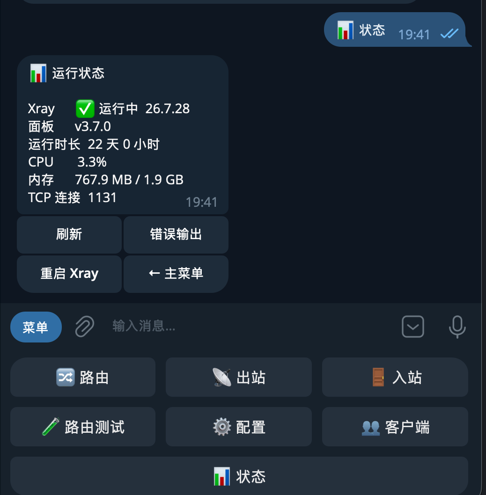

# xui-remote

用 Telegram 管理 3x-ui：改路由、查出站、拿订阅链接，手机上就能操作。

路由改动先暂存，确认后统一提交并重启 Xray。提交前保存快照，提交后取样检查路由是否走向预期出站，有问题可以回滚。



## 能做什么

- **路由**：增删规则、调整顺序、修改匹配条件和目标出站，测试域名或 IP 的实际路由。
- **出站**：查看和删除出站、管理出站订阅、检查连通性，临时指定负载均衡器使用的出站。
- **日常管理**：查看运行状态和错误输出、重启 Xray、启停入站、查询客户端流量和订阅链接及二维码。

## 开始使用

需要一个支持管理员 API Token 的 3x-ui 面板，以及一个独立的 Telegram Bot。运行机器须能访问面板和 Telegram。

从 [Releases](https://github.com/sleepingF0x/xui-remote/releases) 下载对应架构的压缩包（`amd64` 或 `arm64`）：

```bash
curl -fsSL https://github.com/sleepingF0x/xui-remote/releases/latest/download/xui-remote_linux_amd64.tar.gz | tar -xz
cd xui-remote_linux_amd64
cp config.example.yaml config.yaml
```

压缩包里有程序、配置示例和 systemd 服务文件，`checksums.txt` 可用来校验下载。也可以安装 Go 1.27 或更高版本后从源码构建：

```bash
git clone https://github.com/sleepingF0x/xui-remote.git
cd xui-remote
go build -o xui-remote .
cp config.example.yaml config.yaml
```

编辑 `config.yaml`，填好这四项：

| 字段 | 填什么 |
| --- | --- |
| `panel.base_url` | 面板地址 + `webBasePath` + `panel/api/`，见下方示例 |
| `panel.api_token` | 面板中创建的管理员 API Token |
| `telegram.token` | 向 Telegram 的 @BotFather 创建 Bot 后取得的 Token |
| `telegram.allowed_chat_ids` | 允许操作的用户 ID，替换示例中的 `0`；个人 ID 可向 @userinfobot 查询。要在群里使用，再加上群 ID，群里只有同样列出的成员才能操作 |

比如面板地址是 `http://127.0.0.1:2053`，`webBasePath` 是 `/panel/`，则 API 地址为 `http://127.0.0.1:2053/panel/panel/api/`。两个 `panel` 都要保留。其他配置见 [config.example.yaml](config.example.yaml)。

检查连接并启动：

```bash
./xui-remote -config config.yaml -check
./xui-remote -config config.yaml
```

在 Telegram 中向 Bot 发送 `/start`，通过菜单操作。平时也可以直接发送域名或 IP，选择路由测试等操作。

长期运行可参考 [systemd 服务文件](xui-remote.service)，按其中的路径放置程序和配置，并创建对应的服务用户。习惯用 Docker 的用户可使用仓库中的 [Compose 配置](docker-compose.yml)，镜像为 `ghcr.io/sleepingf0x/xui-remote`。`./xui-remote -version` 显示当前版本。

## 改动何时生效

路由和出站配置编辑完成后，到「⚙️ 配置」查看暂存改动并提交。一批改动只重启一次 Xray，**重启会断开现有连接**。提交时若检测到网页面板已改过配置，会提示冲突。

提交后会确认 Xray 仍在运行。新配置导致 Xray 无法启动或被面板拒绝时，会自动把面板恢复为提交前的配置，改动留在暂存区，修正后可再次提交。

提交成功后有 5 分钟确认期：期限内点「✅ 保留改动」才算定下来，否则自动回滚到提交前的配置。改动把你自己的连接弄断时，什么都不用做就会恢复；错过确认也可以在回滚通知里一键恢复。确认期在 Bot 重启后依然有效，可用 `apply.confirm_minutes` 调整，设为 `0` 关闭。期限内若网页面板又改过配置，不会自动回滚。Xray 处于手动停止状态时，提交只保存配置，不做验证，也不进入确认期。

自动验证是取样检查，不代表所有流量都已验证；正则、关键词等无法取样的规则会跳过。路由测试反映的是当前运行配置，不包含未提交的改动。

提交时还会检查有没有误伤：提交前，在旧配置上对改动位置以下、没有改动的规则各取一个样本（最多 20 条）；提交后用同样的目标再测一遍，列出流量去向变了的规则。新加的规则位置太靠前或范围太宽、接走了别的规则的流量时，这里就能看出来。

入站启停会立即执行；出站订阅直接写入面板，需要另行重启 Xray 才生效；负载均衡器的临时指定在重启后失效。这些操作不进入暂存区。快照回滚会整份恢复 Xray 配置模板，不包含入站、客户端和出站订阅。

配置中含有面板管理员凭据，请妥善保管，只允许可信的聊天 ID 操作。不要与面板自带的 Telegram Bot 共用 Token。

遇到面板接口兼容问题，可以运行只读自检：

```bash
./xui-remote -config config.yaml -selftest
```

[MIT License](LICENSE)
